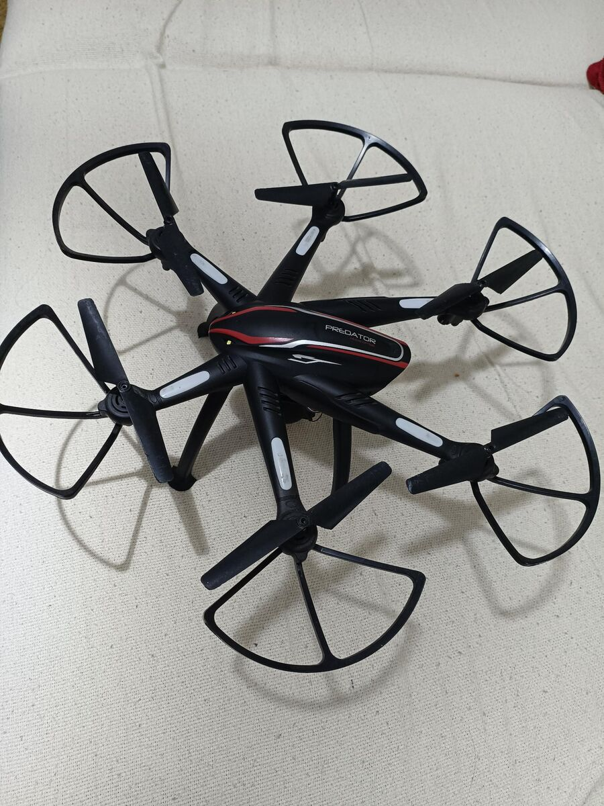

# Predator — controle de drone pelo computador



Controle de um hexacóptero chinês genérico ("Predator", app **LW-FPV**, módulo Wi-Fi **Lewei**) direto do
notebook, sem o app do celular e sem o controle remoto. Base para colocar uma IA pilotando.

Os protocolos foram recuperados por engenharia reversa do APK `com.klh.lwfpv` 1.9.2 (Java com jadx,
bibliotecas nativas ARM64 com Ghidra via [REA](https://github.com/morluto/rea)) e confirmados ao vivo.

## O que funciona

| Recurso | Status |
|---|---|
| Telemetria (inclinação, altura, GPS, bateria, estado) | ✅ confirmado ao vivo |
| Vídeo H.264 1280×720 ~12,5 fps | ✅ confirmado ao vivo |
| Destravar / travar motores | ✅ confirmado ao vivo (hélices giram) |
| Decolar, pousar, pairar, voltar pra casa, manche | 📄 extraído do código, **ainda não testado em voo** |

## Requisitos

- Linux com Python 3.10+, `pygame`, `numpy` e `ffmpeg` (já presentes neste notebook).
- Wi-Fi conectado na rede do drone (`WiFi-1080P-GPS-XXXXXX`). O código prende os sockets na interface
  `wlp2s0` porque a rede de casa (cabo) também usa `192.168.0.x` — ajuste `IFACE` em `predator/link.py`
  e `predator/video.py` se a sua interface tiver outro nome.

## Uso

```bash
python3 controle.py --somente-leitura   # vídeo + telemetria, nenhum comando de voo sai
python3 controle.py                     # controle completo
```

A janela mostra vídeo, telemetria e botões clicáveis para os comandos abaixo; destravar, decolar e voltar
pra casa também pedem dois cliques. Os botões **CÂMERA ▲/▼** só agem enquanto seguros, e o sentido não foi
confirmado: até agora o comando não moveu a câmera neste drone (veja `docs/protocolo.md`).

| Tecla | Ação |
|---|---|
| **ESPAÇO** | **EMERGÊNCIA** — corta os motores na hora (no ar, o drone cai) |
| U U | destravar (dois toques em 1,5 s) |
| J | travar (recusado se estiver voando — use L) |
| T T | decolar (dois toques) |
| L | pousar |
| P | pairar |
| H H | voltar pra casa (dois toques) |
| W/S, A/D, Q/E, R/F | frente/trás, esquerda/direita, girar, subir/descer (só depois de decolar) |
| SHIFT | movimento rápido (±400 em vez de ±200) |
| I / K | câmera para cima / para baixo (enquanto segurar) |
| C / V | foto / liga-desliga gravação (em `capturas/`) |
| F11 | liga/desliga tela cheia (ou abra com `--tela-cheia`) |
| ESC | sair — se destravado, pousa/trava antes e espera; ESC de novo força a saída |

Travas de segurança: no chão o acelerador fica no mínimo e o manche é ignorado; destravar, decolar e
voltar pra casa pedem confirmação; ao fechar com o drone destravado o programa pousa/trava antes.

> ⚠️ Teste voo **só ao ar livre**, em local aberto, sem pessoas por perto, drone no chão e você afastado.
> Os sentidos de W/A/S/D/Q/E/R/F foram deduzidos do padrão RC e precisam ser confirmados no primeiro voo.

## Estrutura

```
controle.py            programa de controle (pygame)
predator/
  link.py              link UDP de controle + telemetria (threads, fila de comandos)
  bt.py                protocolo BT (quadros, comandos, parser de telemetria)
  video.py             cliente de vídeo TCP 7060 + desofuscação + decodificação via ffmpeg
  mdata.py             tabelas de desofuscação extraídas da lib de vídeo
  lwgps.py             protocolo LWGPS (outra variante da mesma lib; NÃO é o deste drone)
scripts/
  probe.py             teste só-leitura de telemetria (com whitelist)
  gps_log.py           registra GPS em CSV até ter sinal firme (só leitura)
  teste_motores.py     destrava 2 s e trava (com whitelist, nunca decola)
  teste_camera.py      testa os canais PTZ com o drone travado e mede se a imagem muda
  teste_camera_destravado.py  mesmo teste com motores em marcha lenta (só SEM hélices)
  scan.py, dis.py      scanner de portas e desmontador ARM64 usados na RE
hardware/
  README.md            placas, conectores, sensores e próximos passos de hardware (com fotos)
docs/
  protocolo.md         como o drone funciona (rede, protocolos, comandos)
  diario-re.md         diário da engenharia reversa (evidências, endereços, testes)
```

Arquivos binários do fabricante (APK, `.so`) e capturas não vão para o repositório (`.gitignore`).
