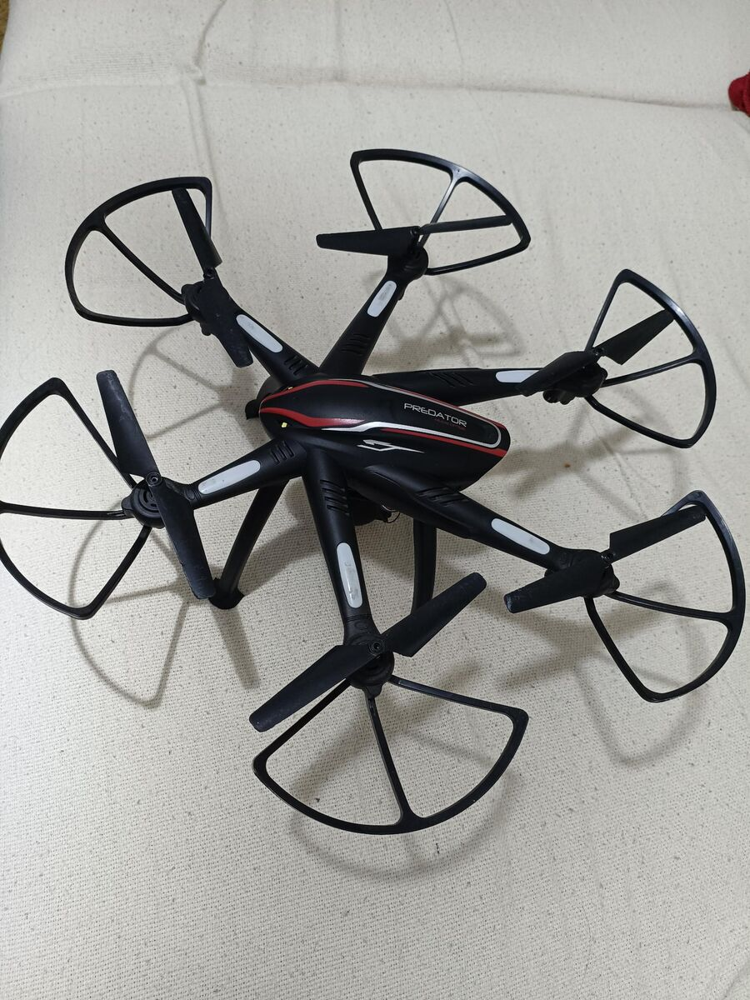
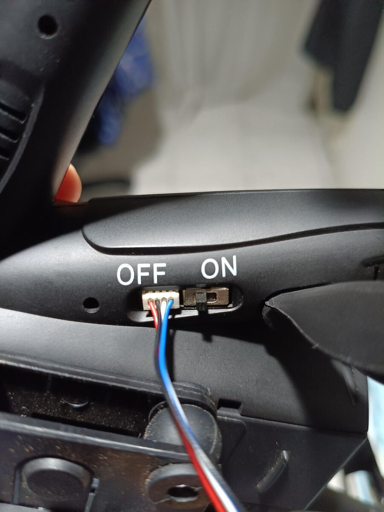
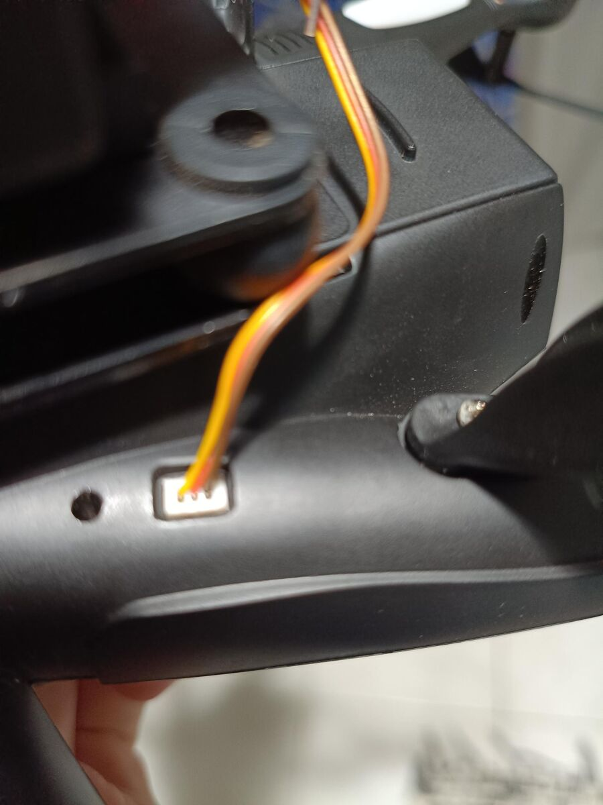
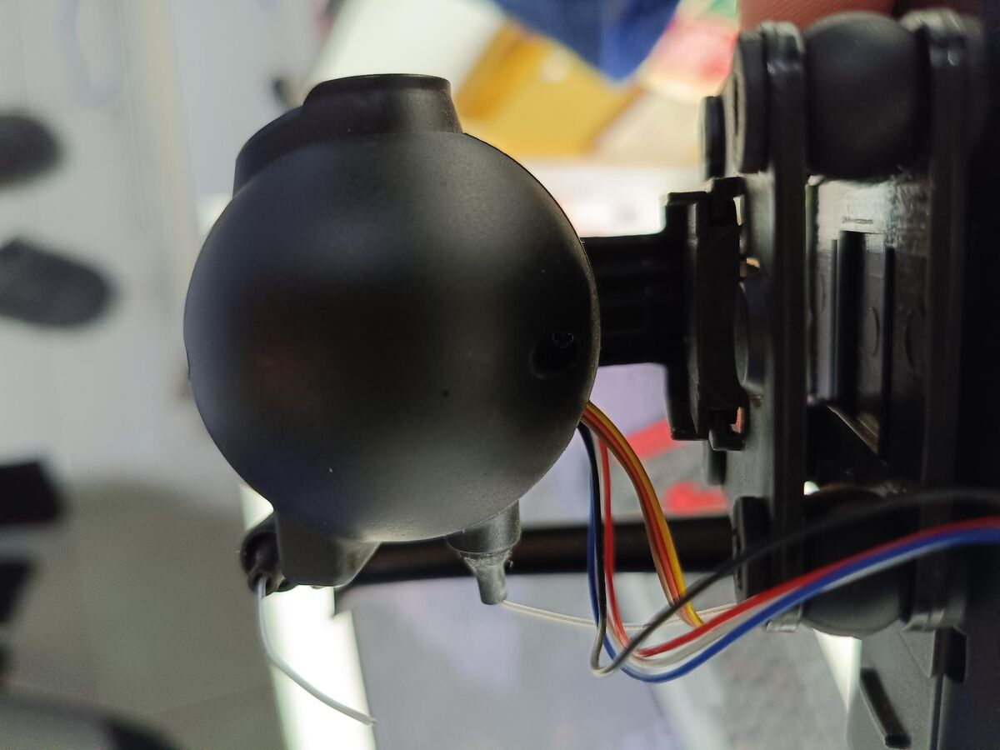
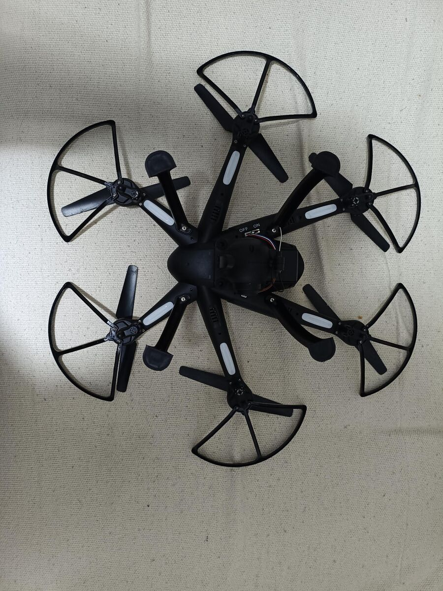
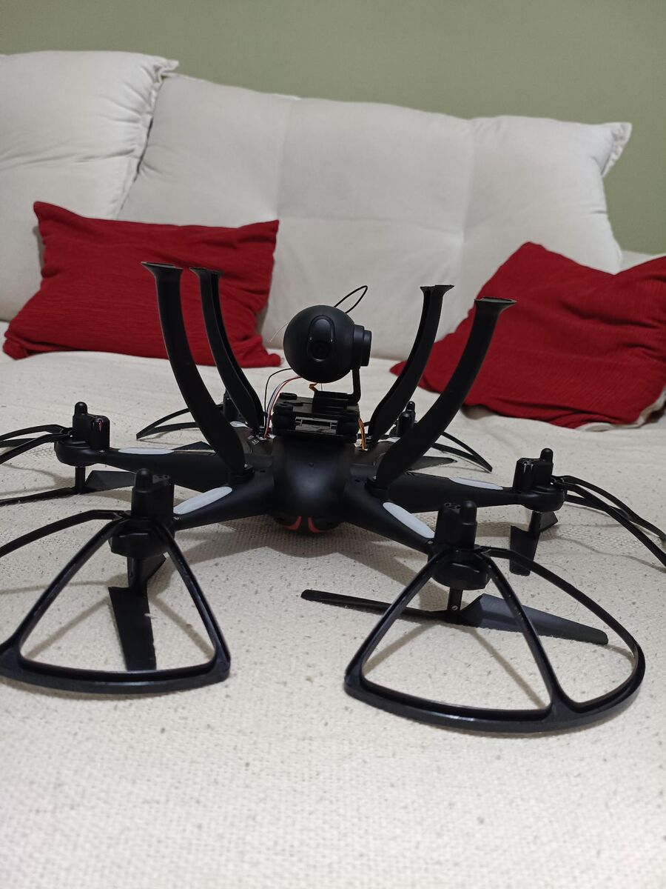

# Hardware

Inspeção externa do drone, **sem desmontar**. Legenda: ✅ observado/confirmado · 🔎 hipótese a medir.



## Arquitetura física

São **duas placas independentes**, ligadas por chicotes externos:

```
 ┌──────────────── corpo (carcaça "PREDATOR") ─────────────────┐
 │  controlador de voo: MCU + IMU + barômetro + bússola        │
 │  drivers dos 6 motores · receptor do controle 2,4 GHz · GPS │
 │  compartimento da bateria (por baixo) + chave ON/OFF        │
 └───────┬───────────────────────────────┬─────────────────────┘
         │ conector 4 pinos              │ conector 3 pinos
         │ (vermelho/preto/branco/azul)  │ (marrom/laranja/amarelo)
         ▼                               ▼
 ┌──────────────────────┐        ┌───────────────────────┐
 │ câmera (bola)        │        │ servo de inclinação   │
 │ SoC Lewei: vídeo     │        │ da câmera (tilt)      │
 │ H.264 + AP Wi-Fi     │        └───────────────────────┘
 │ antena = fio branco  │
 └──────────────────────┘
```

| Observação | Status |
|---|---|
| Sem a câmera conectada, o drone liga e voa normalmente pelo controle 2,4 GHz | ✅ |
| A câmera esquenta bastante parada (codificação H.264 + AP Wi-Fi 5 GHz, sem fluxo de ar) | ✅ |
| O controlador de voo fica no corpo, sobre a bateria, no centro de massa | 🔎 (não aberto) |
| Motores escovados (coreless), pelo tamanho — pouca margem de carga extra | 🔎 |

Isso bate com o protocolo ([`docs/protocolo.md`](../docs/protocolo.md)): o módulo Wi-Fi é só uma ponte
para a serial do controlador de voo (porta TCP 9060 manda `connected` e repassa os quadros BT).

## Conectores

### 4 pinos — corpo ↔ câmera (provável UART) 🔎

Ao lado da chave ON/OFF, embaixo do corpo. Parece JST de 4 vias (medir o passo: 1,25 mm ou 2,0 mm).



| Fio | Função provável | Tensão esperada |
|---|---|---|
| vermelho | alimentação da câmera | ~5 V |
| preto | GND | 0 V |
| branco | TX ou RX | ~3,3 V em repouso |
| azul | RX ou TX | ~3,3 V em repouso |

### 3 pinos — corpo ↔ servo da câmera 🔎

Cores no padrão de servo RC. O sinal deve vir do controlador de voo; candidatos no protocolo: campos
`ptz1`/`ptz2` do manche `0xB5`.



| Fio | Função provável |
|---|---|
| marrom | GND |
| laranja | +5 V |
| amarelo | sinal PWM |



## Sensores

| Tem | Não tem |
|---|---|
| GPS, barômetro (altura relativa, varia ~1 m parado), bússola, IMU | microfone, sonar, lidar, ToF, fluxo óptico |

A "distância" da telemetria `0x89` é a distância até o ponto de decolagem (GPS), não de obstáculos.
O stream de vídeo (TCP 7060) não tem áudio.

## Próximos passos (sem abrir o drone)

1. **Medir tensões** com o drone ligado e a câmera conectada, ponta preta no fio preto:
   vermelho (~5 V?), branco e azul (~3,3 V parados? se der 5 V, precisa de conversor de nível para o ESP32).
2. **Escutar a serial** com um USB-TTL: GND no preto, RX no branco e depois no azul (só escuta, TX desligado).
   Com o app conectado, procurar `42 54 3C` (app → drone) num fio e `42 54 3E` (drone → app) no outro.
   Começar em 115200; testar 57600 e 19200 se não aparecer.
3. **Cabo Y** com conector igual, para ligar um ESP32 no meio sem cortar fios.
4. **Servo**: no chão, motores travados, variar `ptz1`/`ptz2` no `0xB5` e ver se a câmera inclina.

## Ideias de expansão

- **ESP32 por fora, via Wi-Fi** (não precisa abrir): conecta na rede do drone como cliente e fala UDP 50000,
  com bateria 1S própria e um ToF (ex.: VL53L1X) apontado para baixo para pouso preciso.
- **ESP32 na UART** (depois do passo 2): autonomia embarcada falando o protocolo BT por fio.
  Só transmitir depois de entender o tráfego — dois TX na mesma linha (Lewei + ESP32) brigam; o ESP32 deve
  substituir o TX do Lewei ou servir de ponte entre os dois. ESP32 é 3,3 V.
- Manter a carga extra baixa (~10–20 g) e alimentar pelo regulador, não direto da bateria.

## Componentes

| Item | Situação |
|---|---|
| Sensor ToF **VL53L0X (TOF200C)**, I2C, ~1–1,2 m confiável (pior sob sol forte) | escolhido (~R$ 35), ainda não comprado |
| ESP32 (ideal: ESP32-C3 Super Mini, leve) | a definir |
| Bateria atual: **7,4 V (2S), 1500 mAh** — parece gasta | ✅ informado |
| Bateria nova: 7,4 V, de preferência maior capacidade (até ~2000–2200 mAh, se couber e não pesar demais) | a comprar |

Ligação do VL53L0X no ESP32: VCC → 3,3 V, GND → GND, SDA/SCL → dois GPIOs; biblioteca VL53L0X da Pololu.

## Pendências para a próxima sessão no notebook

Coletar com o drone em mãos e registrar aqui:

**Bateria** (a atual parece gasta — perde carga rápido)
- [x] Tensão e capacidade: 7,4 V, 1500 mAh
- [ ] Foto da etiqueta: taxa C e química (LiPo ou Li-ion)
- [ ] Foto do conector de força e, se houver, do conector de balanceamento
- [ ] Dimensões (C × L × A, mm) e peso (g)
- [ ] Medir a tensão com o multímetro: carregada e depois de um voo
- [ ] Verificar se está estufada/deformada — se estiver, parar de usar e descartar em ponto de coleta
- [ ] Cruzar com a telemetria: o byte de bateria do `0x89` é % ou outra unidade?

**Conectores**
- [ ] Tensões do conector de 4 pinos (vermelho, branco, azul em relação ao preto)
- [ ] Escuta da serial no branco e no azul (baudrate, sentido de cada fio)
- [ ] Passo dos pinos do conector de 4 pinos (para o cabo Y)
- [ ] Teste do servo via `ptz1`/`ptz2`

**Etiquetas do drone**
- [ ] Procurar FCC ID / modelo na etiqueta ou na caixa (fotos internas em fcc.report)

## Fotos

| | |
|---|---|
|  |  |
