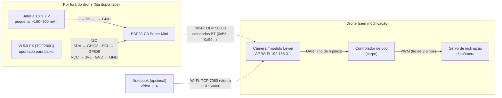
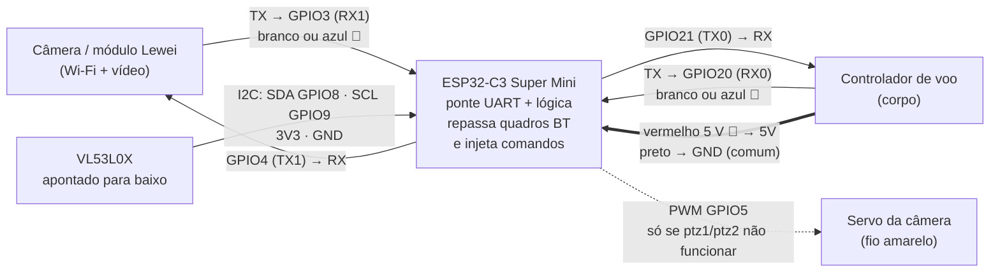

# ESP32 + drone — diagramas de ligação

Dois jeitos de colocar um ESP32 (sugestão: **ESP32-C3 Super Mini**) no drone. Os pinos são sugestões para o
C3 e podem mudar; tudo marcado 🔎 depende das medições pendentes em [`README.md`](README.md).

## Opção A — ESP32 por Wi-Fi (sem tocar nos fios do drone) — começar por aqui

O ESP32 entra na rede do drone como cliente e fala o mesmo protocolo que o notebook (UDP 50000).
Alimentação própria, fixado por fora com fita dupla face ou abraçadeira.

Versão em imagem: [`fotos/esp32-opcao-a-wifi.png`](fotos/esp32-opcao-a-wifi.png)

Cuidado: o drone e o notebook mandando comandos ao mesmo tempo vão brigar. Defina quem manda (por exemplo,
o notebook só assiste o vídeo enquanto o ESP32 pilota, ou o ESP32 só lê o sensor e repassa ao notebook).

## Opção B — ESP32 na UART (depois de medir o conector de 4 pinos)

O ESP32 fica **no meio** do cabo de 4 pinos (cabo Y, sem cortar fios) e vira uma ponte entre a câmera e o
controlador de voo: repassa tudo o que a câmera manda e injeta os próprios comandos. Sem a latência do Wi-Fi.

Versão em imagem: [`fotos/esp32-opcao-b-uart.png`](fotos/esp32-opcao-b-uart.png)

Checklist antes de ligar a opção B:

1. Medir tensões: vermelho ~5 V? branco/azul ~3,3 V? Se a linha for **5 V**, colocar conversor de nível
   (o ESP32 é 3,3 V).
2. Descobrir com o USB-TTL **qual fio sai da câmera e qual sai do controlador** e o baudrate.
3. Primeiro só **escutar** (TX do ESP32 desconectado). Só depois montar a ponte.
4. Nunca ligar um fio do drone direto em outro fio do drone.

## Peso e energia

| Item | Peso aprox. |
|---|---|
| ESP32-C3 Super Mini | ~2 g |
| VL53L0X (TOF200C) | ~2–3 g |
| Bateria 1S pequena (só na opção A) | ~5–10 g |
| Fios, fita | ~2–5 g |

Total na faixa de **10–20 g** — dentro do limite sugerido para motores escovados. Na opção B não há bateria
extra: o ESP32 consome pouco (~100 mA com Wi-Fi ligado, menos sem).
