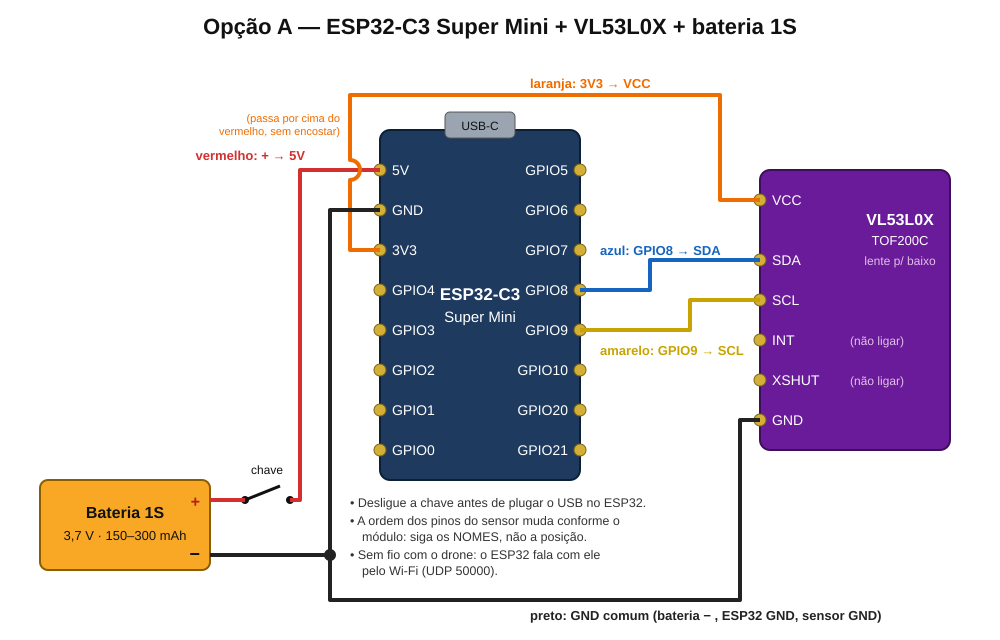
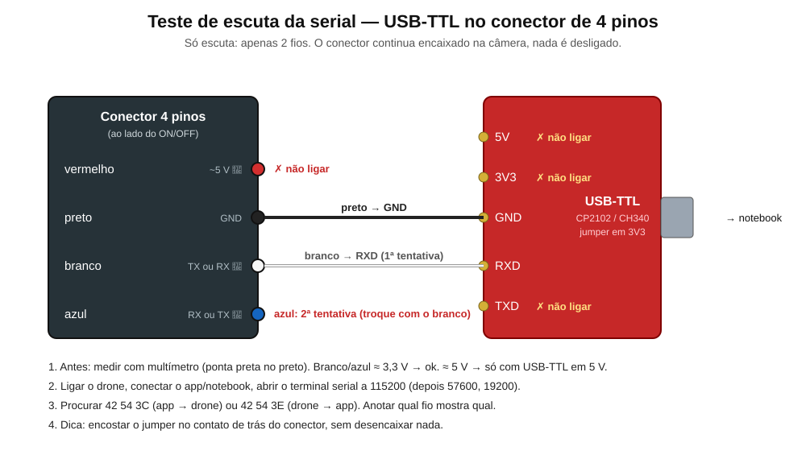

# Ligação elétrica — fio a fio

Siga os **nomes** dos pinos (impressos na placa), não a posição no desenho. Tudo marcado 🔎 ainda depende de
medição (ver [`README.md`](README.md)).

## 1. ESP32 + sensor + bateria (opção A — não mexe no drone)

| Fio (cor sugerida) | De | Para |
|---|---|---|
| vermelho | bateria **+** → chave liga/desliga | ESP32 **5V** |
| preto | bateria **−** | ESP32 **GND** |
| laranja | ESP32 **3V3** | sensor **VCC** (ou VIN) |
| preto | ESP32 **GND** | sensor **GND** |
| azul | ESP32 **GPIO8** | sensor **SDA** |
| amarelo | ESP32 **GPIO9** | sensor **SCL** |
| — | sensor **INT** e **XSHUT** | não ligar |

Cuidados:
- **Desligue a chave antes de plugar o USB** no ESP32 (bateria e USB juntos podem forçar a bateria).
- Bateria 1S (3,7 V) no pino **5V** funciona: o regulador da placa baixa para 3,3 V.
- Nunca ligue a bateria no pino **3V3** — 4,2 V carregada queima o ESP32.
- Primeiro teste na mesa, alimentado só pelo USB (sem bateria): o sensor deve mostrar a distância no Serial Monitor.

## 2. Teste de escuta da serial (USB-TTL no conector de 4 pinos)

| Fio do drone | Liga em (USB-TTL) |
|---|---|
| preto (GND) | **GND** |
| branco | **RXD** (1ª tentativa) |
| azul | **RXD** (2ª tentativa, no lugar do branco) |
| vermelho (~5 V 🔎) | não ligar |
| — | 5V, 3V3 e **TXD** do USB-TTL: não ligar |

Antes: medir branco e azul com o multímetro (ponta preta no preto). ~3,3 V → pode ligar. ~5 V → só com o
USB-TTL ajustado em 5 V (e lembrar que o ESP32 vai precisar de conversor de nível).

Versões em PNG: [`fotos/eletrico-esp32-sensor.png`](fotos/eletrico-esp32-sensor.png),
[`fotos/eletrico-escuta-uart.png`](fotos/eletrico-escuta-uart.png).
